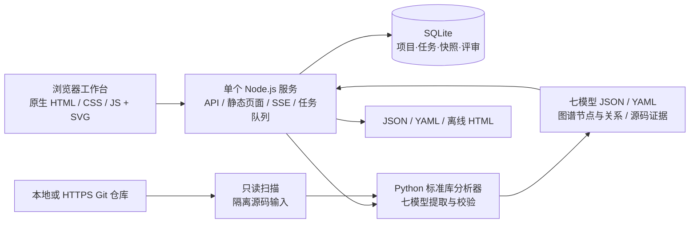

# Ontology Studio · All-in-one 本体建模平台

将代码仓库转换成可查证据、可浏览图谱、可评审修订的七模型工作台。基于 `../ontology-driven-dev/SKILL.md` 的七模型方法及 CardDemo 反向建模成果，实现一个可实际运行的本地技术原型。

## 来源与原始公开仓库

本仓库（[JeffyLiu003/ontology-studio-allinone](https://github.com/JeffyLiu003/ontology-studio-allinone)）是本地技术原型，代码在此仓库内独立实现与维护，并非上游仓库的镜像或分支。

- **方法论与技能来源**：[sharptoolbox/ontology-driven-dev](https://github.com/sharptoolbox/ontology-driven-dev)（公开仓库）。提供「需求探索 → 本体建模 → 应用构建」三步法技能、七模型本体（M1/M2/M3/M5/M6/M7/MU）定义与 `code-paas` 技术底座。本文与 `docs/platform-design.md` 中出现的 `../ontology-driven-dev/SKILL.md` 相对路径（文档内写作 `../../ontology-driven-dev/SKILL.md`）即指该仓库根目录的 `SKILL.md`。
- **上游许可**：上游仓库采用 MIT License（Copyright (c) 2026 sharptoolbox）。引用其方法论、`SKILL.md` 或文档内容时请遵守该许可；本仓库未随附 LICENSE 文件。
- **建模对象**：CardDemo 信用卡示例系统（Java 版）的反向建模成果。本仓库只包含平台自身代码、文档与截图，不包含 CardDemo 源码。
- **未沿用部分**：本工程未使用上游 `code-paas` 技术底座。服务端为单个 Node.js 进程，分析器基于 Python 标准库，数据存放在本地 SQLite，无 npm / pip 第三方依赖。

## 启动

要求 Node.js 24+、Python 3.10+；接入远程仓库时需要 Git。无 npm / pip 第三方依赖，无独立数据库、图数据库、容器或前端构建步骤。

推荐使用 `script` 目录中的启停脚本（macOS / Linux），后台启动后关闭终端也会继续运行：

```sh
cd /path/to/ontology-studio-allinone
./script/start.sh      # 后台启动；已运行时不会重复启动
./script/status.sh     # 查看运行状态、地址、PID 和日志路径
./script/restart.sh    # 停止后重新启动
./script/stop.sh       # 停止，保留模型与评审数据
```

脚本也可使用绝对路径从任意目录运行。等价命令为 `npm run start:background`、`npm run status`、`npm run restart`、`npm run stop`。脚本启停失败时返回非零退出码；重复停止或查询未运行状态正常返回。

后台日志保存在 `.runtime/server.log`，进程信息保存在 `.runtime/service.json`。启动会等待健康检查，停止前会核对进程归属，不按端口批量结束进程。若已有本工程通过 `npm start` 启动的前台实例，脚本可识别并管理；该实例的现有日志仍保留在原终端。

同一个数据目录只管理一个服务实例；自定义端口会记录下来，后续停止/重启无需再次传端口。自定义数据目录时，每次启停都需要传入同一个 `ONTOLOGY_DATA_DIR`；多个实例需使用不同数据目录及端口。

需要前台调试时仍可使用原有方式：

```sh
cd /path/to/ontology-studio-allinone
npm start
```

访问 **http://127.0.0.1:45991**。终端按 Ctrl+C 停止。首次运行自动导入相邻 CardDemo 工程已有本体结果；点击「重新分析」会真实读取当前代码并创建新快照。没有相邻工程时可从空工作空间接入其他仓库。


```sh
ONTOLOGY_PORT=45992 ONTOLOGY_PYTHON=/path/to/python3 npm start
```

- `ONTOLOGY_PORT`：默认 45991。
- `ONTOLOGY_PYTHON`：Python 可执行文件；默认使用系统 PATH 中的 `python3`。
- `ONTOLOGY_DATA_DIR`：数据保存目录，默认工程下 `.runtime`。

不要用静态文件服务器启动 `public/`，它需要平台 API。

## 使用路径

1. 点击「接入代码仓库」，填项目名称与本地工程绝对路径，或无需交互认证的 HTTPS Git 地址。
2. 在「建模任务」查看实际扫描、快照、七模型生成、校验阶段；支持取消、失败后重试。
3. 「项目总览」查看真实模型数量与校验状态；「本体图谱」切换全本体、业务域及对象关系，支持动态力导向布局、拖拽、缩放、点选节点。悬停突出直接邻居，点击保留关联；可按关系类型/证据级别筛选，聚焦一层或两层邻域，并沿入向/出向探索。关系卡片支持跳到相邻节点与源码模型。
4. 「七模型工作台」按 M1/M2/M3/M5/M6/M7/MU、业务域和关键词筛选，或切换覆盖矩阵。
5. 「流程模型」区分业务生命周期与应用执行流程；选择流程查看分支，双击带子流程引用的活动继续下钻。
6. 「查询与报表」查看参数、返回字段及血缘确认状态。点开模型详情可查看源码快照、人工修订名称/描述、记录评审意见。
7. 「版本与导出」切换快照，下载完整 JSON、离线 HTML 报告或七模型 YAML。修订和评审按快照保存，新分析不会覆盖历史。
8. 顶栏搜索（Cmd/Ctrl+K）定位模型；「证据助手」从当前快照检索业务对象与流程，并提供可打开的节点引用。

## 当前支持范围

| 能力 | 已实现范围 |
|---|---|
| 仓库输入 | 本地目录、HTTPS Git；远程重新分析时同步默认分支 |
| 通用分析 | 标准 `src/main/java` 布局的 Java / Spring、多模块 Maven 布局归一化 |
| M1 对象 | JPA 实体、字段、值对象、候选聚合边界；边界需人工评审 |
| M2 行为 | Spring REST 端点、静态应用调用关系 |
| M3 规则 | 可识别领域策略/计算组件；不是可执行规则 DSL |
| M5 主体 | CardDemo 的已核对用户类型及菜单限制；通用仓库不补造角色权限 |
| M6 流程 | Java 方法内的可识别顺序、条件、循环、异常与子流程；CardDemo 另有源码核对的生命周期解释 |
| M7 查询 | GET 查询契约、参数、DTO 返回字段、构造映射与待确认来源 |
| MU 界面 | CardDemo 已有门户/API 分组；通用仓库形成 API 交互契约，不宣称存在对应业务页面 |
| 证据 | 文件路径、行号、SHA256、隔离源码输入快照 |
| 资产管理 | SQLite 项目/任务/快照/评审/语义修订；JSON/HTML/YAML 导出 |

七模型沿用 Skill 的 M1/M2/M3/M5/M6/M7/MU 命名，无 M4。其他语言不会返回 CardDemo 模板充当分析结果，而会提示当前不支持。

这是静态反向建模原型：解析器基于词法和源码模式，不能覆盖反射、运行时依赖、复杂泛型和全部 Java 语法；不运行目标业务系统。角色授权、业务规则完整性、跨服务事务及未确认字段血缘需要后续领域评审。结构检查通过不表示业务规格已经完整，所有快照保留 `manifest.complete=false`。

证据助手是本地语义检索，并非外部大模型。目前不支持自由画布新增任意本体类型、可执行流程部署、权限治理、多人协同和模型版本自动合并。语义编辑支持现有节点的名称及描述。

YAML 文件使用 JSON 序列化，符合 YAML 1.2；离线 HTML 提供可搜索目录、属性和证据，完整交互拓扑需在平台内查看。

## 简化架构



没有额外图数据库、消息队列、搜索服务或外部模型服务。图谱关系在建模产物中保存，浏览器用 SVG 渲染。

## 数据与边界

- `.runtime/studio.sqlite`：项目、任务、快照索引、人工评审与语义修订。
- `.runtime/runs/<job>/source/`：该任务实际分析的源码输入。
- `.runtime/runs/<job>/artifacts/`：模型、源码映射、文件清单、校验结果。
- `.runtime/repos/`：平台管理的远程仓库浅克隆。
- 输入最多 6000 个分析文件 / 60MB，超过 2MB 的单文件跳过并记录；忽略构建产物、依赖目录和符号链接。
- 不执行目标仓库的构建、安装脚本或工作区钩子。本地仓库不写入；远程仓库的更新仅发生在平台自己的克隆副本。
- 默认仅绑定 `127.0.0.1`，面向单人本地原型；不要直接作为多人公网服务部署。
- 重新建模仍读取当次扫描时的工作区；扫描过程不对原仓库加锁，避免同时大批量改动源码。源码行号与哈希指向任务快照，不证明整个仓库是事务性 Git 快照。
- 分析结果及评审持久保存，不自动清理；数据备份时一并保留 SQLite 与 runs/snapshots 目录。

## 验证

```sh
npm test
```

自动化验证覆盖：仓库输入校验、新 Java 仓库真实生成七模型、源码快照隔离、非法源码读取阻止、评审/修订持久化、JSON/YAML/HTML 导出、不支持语言的明确失败、证据检索、运行/排队任务取消。

当前 CardDemo 已通过平台重新分析：28 模块、56 对象、158 行为、92 流程、79 查询、493 节点、1056 关系。远程 HTTPS 克隆路径已实现，本次未用外网仓库执行网络验收。

进一步设计见 [平台建模与实现说明](docs/platform-design.md)。

## 图谱动态交互

- 节点颜色区分七模型；大小反映当前视图的关联数量，业务域节点单独展示。
- 悬停节点突出直接邻居与连线，其余元素降低亮度；点击后保留选择，点击画布或「重置图谱选择」恢复。
- 选中后的关系卡片展示出向/入向数量、关系名称与待评审标记；点击相邻节点继续探索，「查看模型」打开原有证据详情。
- 「聚焦邻域」及一层/两层选项仅遍历已有图边；方向筛选控制遍历方向，不补造传递关系。当前视图计数随过滤更新。
- 连线箭头与流动粒子仅表示关系方向，不是业务运行、调用耗时或实时执行数据。虚线对应 `MAPPED` 语义映射，保留待评审状态。
- 布局逐步稳定后停止运算；可暂停/继续，页面离开时清理动画。系统启用「减少动态效果」时取消布局动画与粒子。
- 双击业务域进入域视图，双击流程进入流程工作台；双击其他模型聚焦其直接邻域。流程工作台保留顺序、条件与异常拓扑。

图谱右上角提供「放大」「缩小」「适应」「全屏」按钮。全屏后可继续筛选、探索节点和查看模型证据；点击「退出全屏」或按 Esc 返回。浏览器不支持原生全屏时自动使用页面内全屏。

## 删除建模任务

任务中心为已完成、失败、已取消及排队任务提供「删除任务」。确认后清理任务记录及日志、该任务的整个 runs 目录（模型、YAML、源码副本、映射与校验文件）、关联快照的评审和语义修订，并使已删除快照无法再查询或导出。

原始本地代码仓库始终保留。删除最后一个任务后，若项目也没有剩余快照，会一并清理项目入口及平台管理的远程克隆；仍有其他任务或独立导入快照的项目会保留。删除当前快照时回退到最近保留的快照。运行中的任务需先取消，等待停止后删除。

项目选择器为历史遗留的空项目提供「清理」按钮；有任务或快照的项目不可直接清理。项目列表在打开时重新读取，清空项目后重启也不会重新自动导入示例项目。

文件先移到平台内部暂存目录，再事务性删除数据库记录。清理记录支持重启恢复；文件删除失败会显示待清理提示，可点击「重试文件清理」。这是永久删除功能，已导出到其他目录的副本不在平台清理范围内。

## 覆盖诊断与快照比较

- 「覆盖与质量」展示扫描语言、框架特征、模块候选匹配、命令流程与查询契约覆盖、证据元数据和评审状态，并可按问题级别/业务域搜索和查看源码。
- 旧版快照没有扫描清单时显示未知；重新分析会记录清单与输入指纹。静态覆盖、结构检查、证据完整度均不是业务准确率。
- 「快照差异」选择同一项目的基线与目标，比较新增/删除/修改的模型和关系，查看字段、规则、流程及查询契约变化，导出差异 JSON。
- 原始提取结果与包含人工语义修订是两种独立比较口径。行号、哈希和证据片段不计为模型内容变化，证据变化单列；未提取出变化不能证明业务行为未变。
- 比较结果提供一层静态关联复核范围；重命名可能呈现为删除与新增。当前仍为全量分析后比较，尚未实现增量解析、运行时影响证明或自动继承评审。
- 下一阶段编码上下文包方案见 [任务 3 方案](docs/coding-context-proposal.md)，当前仅供决策，尚未实现导出或 Agent 接入。

## 从知识文档目录建模

点击「接入建模资料」→「知识目录」→「选择目录」，或填写本机绝对路径，命名项目后开始生成。平台递归读取 UTF-8 Markdown、TXT、HTML、DOCX；最多500个候选文件、20MB输入、单文件2MB。隐藏目录、依赖、运行目录与符号链接不参与扫描。PDF、扫描件、旧版DOC、电子表格和幻灯片暂不支持，会在资料范围中单独列出。

本地文档适配器参考 `ontology-driven-dev` 的 V9 七模型职责与引用规范，识别明确的标题、表格或 `业务对象：合同`、`行为：提交合同` 等声明；支持技能范例中的附录C对象/行为/规则/角色/流程/查询表格。普通叙述没有明确模型定义时会报告未识别，而不会返回示例模型。此入口不调用外部大模型，不等同于完整执行技能的需求探索、人工确认与正式建模阶段。

结果为 `DOCUMENT_MODELING_DRAFT`，所有候选待评审，`manifest.complete=false`。输出七模型JSON兼容YAML、拓扑图、离线HTML及文档清单；重复文档标识可合并证据。文档分组不等于已确认业务域，同名候选及跨文档引用需要领域核验。M6保留原文而不生成无依据的活动分支，M7保留查询定义及待确认的M2绑定，M5不代表已实现授权。文件齐备不代表通过完整V9正式模型校验，也不应直接用于生成生产业务系统。

每次任务保存独立证据快照及SHA256；Markdown/TXT按原文行号，HTML/DOCX按提取文本行号查看，原始文件摘要另存于 `documentInventory.files[].originalSha256`。修改原目录不会改写历史快照。重新分析、取消、评审、语义编辑、快照比较及任务删除沿用现有流程；删除模型不会删除原始知识目录。

后台接口：`GET /api/directories?path=绝对路径` 浏览目录；`POST /api/projects` 传入 `{name,repository:"文档目录绝对路径",sourceType:"documents"}` 创建文档项目。相同路径的源码与文档项目分别管理。


### 输入类型自动识别与旧任务恢复

默认的「本地目录 · 自动识别」在发现 `src/main/java` 主源码时使用 Java 适配器；纯文档目录自动采用知识解析器。选择目录后显示文档数、Java 文件数及即将使用的解析器。混合目录可通过「知识目录」明确指定仅解析文档。

历史上误建为本地代码、尚无模型快照的文档项目，重新分析时会自动修正为知识项目并保留原项目标识。旧 Java 错误卡片提供「按知识目录重试」。已有模型快照的代码项目不直接转换输入类型，需接入独立知识项目，避免混淆历史证据。

知识解析支持对象/角色/规则表格、DDD聚合根清单、带列定义的对象章节、F-xxx功能清单、BR/NR规则编号及方法路径API表格。GET定义可生成与M2绑定的M7查询草稿；流程旅程保留叙述证据。文档声称的“已实现”仍只是文档声明，不替代源码或运行验证。

## 大模型辅助建模与业务确认

在「能力与设置 → 大模型接入」中选择 DeepSeek、兼容 Chat Completions 的企业网关或本机/内网模型，填写 Base URL、模型名和 API Key，可先「测试连接」再保存并启用。DeepSeek 默认地址为 `https://api.deepseek.com`，协议参考[官方连接说明](https://api-docs.deepseek.com/quick_start/agent_integrations/)与[JSON输出说明](https://api-docs.deepseek.com/guides/json_mode/)。本机兼容服务可填写如 `http://127.0.0.1:11434/v1`，模型名称以本机已部署的模型为准。服务不支持 `response_format` 时可关闭「JSON输出模式」，后台仍校验返回结构。

- 任务中心：已完成或失败的任务提供「大模型分析不确定项／大模型辅助解析」。源码、非标准源码布局、文档知识均可提供文本证据；PDF和扫描件仍需先转换。
- 覆盖与质量：可针对单条诊断「与大模型分析此问题」，或整体分析当前快照。
- AI分析与确认：查看进度、调用范围、Token用量、模型建议、已核验的引用片段和业务问题。模型猜测或不存在的引用不作为有效证据。可以勾选有依据的建议写入新草稿、驳回建议，或保存业务答复后再次分析。业务答复会保存为独立证据，并提供给后续模型分析。
- 自动流程：可独立启用「本地解析后自动分析不确定项」和「自动写入有证据的新建议」。自动请求串行排队，失败不会破坏本地模型；修改已有元素仍需手动选择。自动写入只产生待评审草稿，不将模型判断标记为人工已确认。
- 证据助手：启用模型问答后，结合当前快照检索到的模型及证据回答；未启用时保留本地检索。

每轮输入按字符上限、文件数量和窗口采样，分析报告明确显示覆盖范围；这不是对整个仓库的无遗漏分析。常见密钥、密码、16位卡号和SSN作基础脱敏，但不保证识别所有敏感信息。配置云端服务意味着把选中的限量证据发送给该服务；银行资料可配置内网部署。

密钥通过AES-256-GCM加密保存于本机 `.runtime/llm-settings.json`，主密钥 `.runtime/.llm-secret` 权限为0600。浏览器只获得是否已保存密钥的标志。切换服务域名会清除旧密钥，防止凭据误投。主密钥与密文同机保存，防护范围是避免配置明文和普通误读，不能防御拥有相同系统用户权限的攻击者。备份时需妥善保管这两个文件。

AI结果进入 `ai_runs`，含提供商、模型、时间、用量、结论、证据及人工答复；不记录API Key。补充模型按新快照保存，保留历史结果及未修改元素的人工评审，修改元素重新待评审。写入前检查图谱引用、ID、证据和M7/M2绑定；不声明通过完整V9形式化校验或业务验收。已产生新版本时，旧分析不得覆盖当前版本。运行中的模型分析可取消，重启中断会明确标记；删除任务也会清理其AI记录、关联快照及文件。

后台接口：

- `GET/PUT /api/llm/config`：读取脱敏配置／保存配置。
- `POST /api/llm/test`：测试当前或尚未保存的配置，仅发送测试文字。
- `POST /api/projects/:id/ai/analyze`：以 `jobId` 或 `snapshotId` 开始分析，可附 `issueId` 聚焦诊断。
- `GET /api/projects/:id/ai/runs`：分析历史。
- `POST /api/projects/:id/ai/:runId/cancel|apply|reject|answer`：取消、写入草稿、驳回建议或保存业务答复。

## 业务语义与五层建模

新增「业务语义与分层」：保留七模型，额外建立统一定义、关系词表、字段与状态、实现映射和证据断言。默认五层为系统／业务子域候选／业务对象／业务规则／字段语义，是项目知识组织模板，不宣称是IBM唯一或官方五级规范。模块与文档分组不能直接证明业务域；继承、归属、组成、约束与引用不得混为一类。

代码结构提取、推断映射、文档声明、AI建议分别标记。语义层将聚合边界保留为候选，展示原解析分类和待验证项；不因@Entity存在就认定业务聚合正确。状态集合不等于状态迁移。原始未知关联保留名称并产生待分类诊断，不根据中文连线名自动造正式关系。

每条断言具有稳定ID、主体、关系、客体、来源文件／行号／SHA256、快照版本和独立评审状态。节点被确认不会自动确认其全部关系。具有证据且无引用或类型阻断的断言可独立确认；缺证据关系不能直接确认。评审按快照保存，删除任务时随关联快照清理。历史快照读取时动态兼容，新快照同时保存语义投影。

提供OWL本体Turtle、SHACL shapes及语义JSON导出。OWL包含业务模型定义的元模型、M1业务概念的候选类和逐条重述的RDF断言；生产账户与交易实例不会由类名虚构。未确认关系只作为待评审声明保存，不自动输出为已认可的关系事实；独立确认且有证据的关系才输出直接三元组。不自动生成owl:sameAs、类等价或把五级归属变成rdfs:subClassOf。

当前执行 `local-semantic-profile-v1` 内置引用、关系主体／目标类型、证据缺口及业务缺口检查。导出标准格式不代表运行了完整OWL推理器或SHACL引擎；UI与API明确给出 `owlReasonerExecuted=false`、`shaclEngineExecuted=false`。该版本不新增图数据库或第三方推理服务。

接口：`GET /api/projects/:id/semantic`；`PUT /api/projects/:id/semantic/assertions/:assertionId?snapshot=...` 保存独立评审；`GET /api/projects/:id/export?format=owl|shacl|semantic` 导出。源码项目的大模型证据采样在同等定位优先级下优先代码，文档项目仍按文档模式处理。

## 独立交付与迁移

默认启动空工作空间，不自动读取相邻的 CardDemo 或技能工程。需要导入已有示例时显式指定：

```bash
ONTOLOGY_IMPORT_BASELINE=/absolute/path/ontology-data.json ONTOLOGY_BASELINE_SOURCE=/absolute/path/source ./script/start.sh
```

导入只在工作空间没有项目时执行。普通代码、文档项目继续通过界面接入。技能仓库是方法论参考，不是运行依赖。

Python 默认使用系统 PATH 中的 `python3`，可用 `ONTOLOGY_PYTHON=/absolute/path/python3` 显式指定，不再自动选择 Codex 缓存环境。

平台内部快照以相对数据目录的路径保存，读取时动态还原。启动会将可识别的历史内部绝对路径转换为相对路径；真正的外部文件引用保持原样。迁移请停止服务后完整复制数据目录（默认 `.runtime`），不要只复制SQLite；源代码／知识仓库是分析输入，仍需在新机器提供对应路径。密钥配置及主密钥也需随数据目录妥善迁移。移动后如需重新解析，原始输入项目路径需要另行调整。
