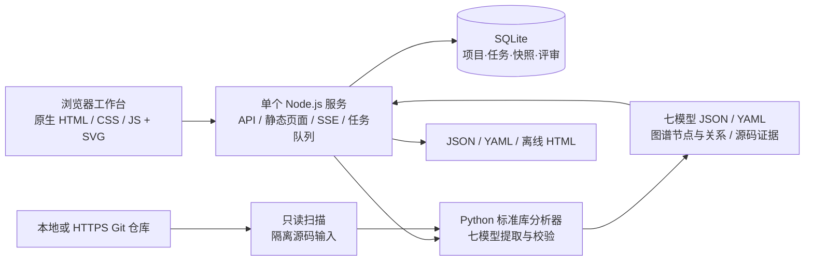

# Ontology Studio · All-in-one 本体建模平台

将代码仓库转换成可查证据、可浏览图谱、可评审修订的七模型工作台。基于 `../ontology-driven-dev/SKILL.md` 的七模型方法及 CardDemo 反向建模成果，实现一个可实际运行的本地技术原型。

## 来源与原始公开仓库

本仓库（[JeffyLiu003/ontology-studio-allinone](https://github.com/JeffyLiu003/ontology-studio-allinone)）是本地技术原型，代码在此仓库内独立实现与维护，并非上游仓库的镜像或分支。

- **方法论与技能来源**：[sharptoolbox/ontology-driven-dev](https://github.com/sharptoolbox/ontology-driven-dev)（公开仓库）。提供「需求探索 → 本体建模 → 应用构建」三步法技能、七模型本体（M1/M2/M3/M5/M6/M7/MU）定义与 `code-paas` 技术底座。本文与 `docs/platform-design.md` 中出现的 `../ontology-driven-dev/SKILL.md` 相对路径（文档内写作 `../../ontology-driven-dev/SKILL.md`）即指该仓库根目录的 `SKILL.md`。
- **上游许可**：上游仓库采用 MIT License（Copyright (c) 2026 sharptoolbox）。引用其方法论、`SKILL.md` 或文档内容时请遵守该许可；本仓库未随附 LICENSE 文件。
- **建模对象**：CardDemo 信用卡示例系统（Java 版）的反向建模成果。本仓库只包含平台自身代码、文档与截图，不包含 CardDemo 源码。
- **未沿用部分**：本工程未使用上游 `code-paas` 技术底座。服务端为单个 Node.js 进程，分析器基于 Python 标准库，数据存放在本地 SQLite，无 npm / pip 第三方依赖。

## 启动

要求 Node.js 24+、Python 3.10+；接入远程仓库时需要 Git。无 npm / pip 第三方依赖，无独立数据库、图数据库、容器或前端构建步骤。

推荐使用 `script` 目录中的启停脚本（macOS / Linux），后台启动后关闭终端也会继续运行：

```sh
cd /Users/louis/work-space/Code-projects/Codex/icode-demo/ontology-studio-allinone
./script/start.sh      # 后台启动；已运行时不会重复启动
./script/status.sh     # 查看运行状态、地址、PID 和日志路径
./script/restart.sh    # 停止后重新启动
./script/stop.sh       # 停止，保留模型与评审数据
```

脚本也可使用绝对路径从任意目录运行。等价命令为 `npm run start:background`、`npm run status`、`npm run restart`、`npm run stop`。脚本启停失败时返回非零退出码；重复停止或查询未运行状态正常返回。

后台日志保存在 `.runtime/server.log`，进程信息保存在 `.runtime/service.json`。启动会等待健康检查，停止前会核对进程归属，不按端口批量结束进程。若已有本工程通过 `npm start` 启动的前台实例，脚本可识别并管理；该实例的现有日志仍保留在原终端。

同一个数据目录只管理一个服务实例；自定义端口会记录下来，后续停止/重启无需再次传端口。自定义数据目录时，每次启停都需要传入同一个 `ONTOLOGY_DATA_DIR`；多个实例需使用不同数据目录及端口。

需要前台调试时仍可使用原有方式：

```sh
cd /Users/louis/work-space/Code-projects/Codex/icode-demo/ontology-studio-allinone
npm start
```

访问 **http://127.0.0.1:45991**。终端按 Ctrl+C 停止。首次运行自动导入相邻 CardDemo 工程已有本体结果；点击「重新分析」会真实读取当前代码并创建新快照。没有相邻工程时可从空工作空间接入其他仓库。

```sh
ONTOLOGY_PORT=45992 ONTOLOGY_PYTHON=/path/to/python3 npm start
```

- `ONTOLOGY_PORT`：默认 45991。
- `ONTOLOGY_PYTHON`：Python 可执行文件；优先使用本机已有 Codex Python，找不到则使用 `python3`。
- `ONTOLOGY_DATA_DIR`：数据保存目录，默认工程下 `.runtime`。

不要用静态文件服务器启动 `public/`，它需要平台 API。

## 使用路径

1. 点击「接入代码仓库」，填项目名称与本地工程绝对路径，或无需交互认证的 HTTPS Git 地址。
2. 在「建模任务」查看实际扫描、快照、七模型生成、校验阶段；支持取消、失败后重试。
3. 「项目总览」查看真实模型数量与校验状态；「本体图谱」切换全本体、业务域及对象关系，支持动态力导向布局、拖拽、缩放、点选节点。悬停突出直接邻居，点击保留关联；可按关系类型/证据级别筛选，聚焦一层或两层邻域，并沿入向/出向探索。关系卡片支持跳到相邻节点与源码模型。
4. 「七模型工作台」按 M1/M2/M3/M5/M6/M7/MU、业务域和关键词筛选，或切换覆盖矩阵。
5. 「流程模型」区分业务生命周期与应用执行流程；选择流程查看分支，双击带子流程引用的活动继续下钻。
6. 「查询与报表」查看参数、返回字段及血缘确认状态。点开模型详情可查看源码快照、人工修订名称/描述、记录评审意见。
7. 「版本与导出」切换快照，下载完整 JSON、离线 HTML 报告或七模型 YAML。修订和评审按快照保存，新分析不会覆盖历史。
8. 顶栏搜索（Cmd/Ctrl+K）定位模型；「证据助手」从当前快照检索业务对象与流程，并提供可打开的节点引用。

## 当前支持范围

| 能力 | 已实现范围 |
|---|---|
| 仓库输入 | 本地目录、HTTPS Git；远程重新分析时同步默认分支 |
| 通用分析 | 标准 `src/main/java` 布局的 Java / Spring、多模块 Maven 布局归一化 |
| M1 对象 | JPA 实体、字段、值对象、候选聚合边界；边界需人工评审 |
| M2 行为 | Spring REST 端点、静态应用调用关系 |
| M3 规则 | 可识别领域策略/计算组件；不是可执行规则 DSL |
| M5 主体 | CardDemo 的已核对用户类型及菜单限制；通用仓库不补造角色权限 |
| M6 流程 | Java 方法内的可识别顺序、条件、循环、异常与子流程；CardDemo 另有源码核对的生命周期解释 |
| M7 查询 | GET 查询契约、参数、DTO 返回字段、构造映射与待确认来源 |
| MU 界面 | CardDemo 已有门户/API 分组；通用仓库形成 API 交互契约，不宣称存在对应业务页面 |
| 证据 | 文件路径、行号、SHA256、隔离源码输入快照 |
| 资产管理 | SQLite 项目/任务/快照/评审/语义修订；JSON/HTML/YAML 导出 |

七模型沿用 Skill 的 M1/M2/M3/M5/M6/M7/MU 命名，无 M4。其他语言不会返回 CardDemo 模板充当分析结果，而会提示当前不支持。

这是静态反向建模原型：解析器基于词法和源码模式，不能覆盖反射、运行时依赖、复杂泛型和全部 Java 语法；不运行目标业务系统。角色授权、业务规则完整性、跨服务事务及未确认字段血缘需要后续领域评审。结构检查通过不表示业务规格已经完整，所有快照保留 `manifest.complete=false`。

证据助手是本地语义检索，并非外部大模型。目前不支持自由画布新增任意本体类型、可执行流程部署、权限治理、多人协同和模型版本自动合并。语义编辑支持现有节点的名称及描述。

YAML 文件使用 JSON 序列化，符合 YAML 1.2；离线 HTML 提供可搜索目录、属性和证据，完整交互拓扑需在平台内查看。

## 简化架构



没有额外图数据库、消息队列、搜索服务或外部模型服务。图谱关系在建模产物中保存，浏览器用 SVG 渲染。

## 数据与边界

- `.runtime/studio.sqlite`：项目、任务、快照索引、人工评审与语义修订。
- `.runtime/runs/<job>/source/`：该任务实际分析的源码输入。
- `.runtime/runs/<job>/artifacts/`：模型、源码映射、文件清单、校验结果。
- `.runtime/repos/`：平台管理的远程仓库浅克隆。
- 输入最多 6000 个分析文件 / 60MB，超过 2MB 的单文件跳过并记录；忽略构建产物、依赖目录和符号链接。
- 不执行目标仓库的构建、安装脚本或工作区钩子。本地仓库不写入；远程仓库的更新仅发生在平台自己的克隆副本。
- 默认仅绑定 `127.0.0.1`，面向单人本地原型；不要直接作为多人公网服务部署。
- 重新建模仍读取当次扫描时的工作区；扫描过程不对原仓库加锁，避免同时大批量改动源码。源码行号与哈希指向任务快照，不证明整个仓库是事务性 Git 快照。
- 分析结果及评审持久保存，不自动清理；数据备份时一并保留 SQLite 与 runs/snapshots 目录。

## 验证

```sh
npm test
```

自动化验证覆盖：仓库输入校验、新 Java 仓库真实生成七模型、源码快照隔离、非法源码读取阻止、评审/修订持久化、JSON/YAML/HTML 导出、不支持语言的明确失败、证据检索、运行/排队任务取消。

当前 CardDemo 已通过平台重新分析：28 模块、56 对象、158 行为、92 流程、79 查询、493 节点、1056 关系。远程 HTTPS 克隆路径已实现，本次未用外网仓库执行网络验收。

进一步设计见 [平台建模与实现说明](docs/platform-design.md)。

## 图谱动态交互

- 节点颜色区分七模型；大小反映当前视图的关联数量，业务域节点单独展示。
- 悬停节点突出直接邻居与连线，其余元素降低亮度；点击后保留选择，点击画布或「重置图谱选择」恢复。
- 选中后的关系卡片展示出向/入向数量、关系名称与待评审标记；点击相邻节点继续探索，「查看模型」打开原有证据详情。
- 「聚焦邻域」及一层/两层选项仅遍历已有图边；方向筛选控制遍历方向，不补造传递关系。当前视图计数随过滤更新。
- 连线箭头与流动粒子仅表示关系方向，不是业务运行、调用耗时或实时执行数据。虚线对应 `MAPPED` 语义映射，保留待评审状态。
- 布局逐步稳定后停止运算；可暂停/继续，页面离开时清理动画。系统启用「减少动态效果」时取消布局动画与粒子。
- 双击业务域进入域视图，双击流程进入流程工作台；双击其他模型聚焦其直接邻域。流程工作台保留顺序、条件与异常拓扑。
